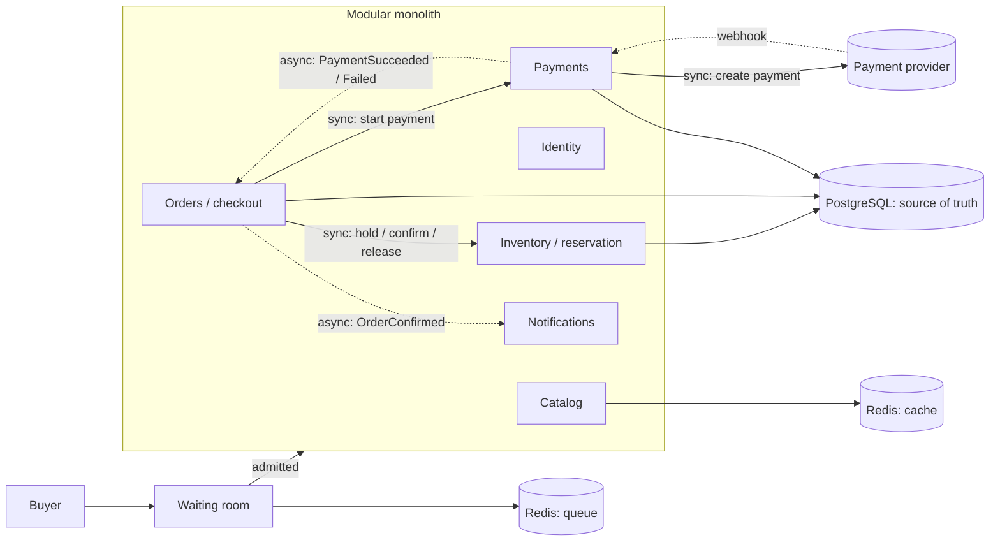

# Ticketing Platform — Architecture v0

> Status: v0 — first version, expected to be wrong in places. Every risk below says how we will find out.
> Authorship: mentor-written worked example (D002). Learner to review, challenge and own.

## 1. Context

A ticketing platform for large events in Egypt and the Gulf. Popular on-sales open at an announced time,
and far more people want tickets than exist: up to **400,000 buyers for 75,000 seats in the first 10 minutes**.
The hard part is not selling tickets. It is saying **"no" to most people quickly, fairly and cheaply**,
while **never selling the same seat twice**.

## 2. Functional requirements

**Buyer**
- Browse events and see a venue's seat map with current availability.
- Join the waiting room when an on-sale opens and be admitted in order.
- Hold up to **4 tickets per account per event**:
  - reserved sections: pick specific seats;
  - standing (GA) zones: pick a quantity only.
- A hold lasts **10 minutes**. If payment is not confirmed in that time, the seats return to sale.
- Pay by card or wallet through an external payment provider (PSP).
- A ticket is **sold** only when the PSP confirms the capture. Then a ticket (QR code) is issued and sent.
- See a clear "sold out" message as soon as nothing is left.

**Organizer / ops**
- Create events: venue, sections, seats, GA zone capacities, prices, on-sale time.
- See live sales counts per event.

## 3. Non-functional requirements

| Category | Requirement |
| --- | --- |
| Correctness | **Zero overselling.** Postgres is the only authority on seat state. Availability shown to buyers may be stale for a few seconds; a sale may never be. |
| Consistency trade-off | Temporarily unsold seats (held, then released) are acceptable. A small number unsold at the end is tolerable. |
| Latency | Hold a seat: p95 < 300 ms at peak. Seat map: p95 < 500 ms, data up to ~5 s stale. |
| Availability | 99.9% during on-sale windows; that is when downtime is most expensive. |
| Fairness | Buyers are admitted in arrival order. People who cannot get a seat are told quickly (sold-out shown within ~10 s of the last seat selling), for all the held not yet sold tickets we are having message for the queue All seats are currently held; some may become available.” , and their traffic must not slow checkout for people who are buying. |
| Abuse | Bots are a known problem: per-account limit enforced server-side; bot defence at the waiting-room door. |
| Region | Single region near Egypt (~90% of buyers). No multi-region in v0. |

## 4. Capacity estimate

**Given (product owner):** 400k buyers in the first 10 min · 75k seats (~60k reserved, ~15k GA) · 10-min hold · 4/account.

**Assumptions (ours):**
- ~10 requests per buyer over a 1–3 minute visit.
- Half of buyers arrive in the first 30 s.
- An active buyer sends ~1 request every 3 s.
- ~75% of requests are reads, ~25% writes.

**Steps:**
1. Average arrivals: 400k / 600 s ≈ **670 buyers/s** → ≈ 6.7k req/s.
2. Opening: 200k buyers active in the first 30 s × 1 req / 3 s ≈ **67k req/s** — about **10× the average**.
3. Split at peak: ≈ **50k reads/s** (event page, seat map, refresh) and ≈ **15–20k writes/s** (hold attempts, including retries after losing a seat).
4. Opening burst: at T=0, 100–400k first page loads arrive within ~1 second.
5. Confirm-payment and hold-release are not part of the peak: confirms trickle in over minutes; releases are timer-driven background work.

**What it means:**
- The opening burst cannot hit the app directly → a **waiting room** with admission control is required.
- Reads can be served from cache because they may be a few seconds stale.
- The danger is not the write total; it is that writes **target the same few thousand popular seats** → row contention in Postgres.
- Admission control turns an uncontrolled write load into one we choose (e.g. admit N buyers/s into seat selection).

## 5. Module boundaries

One deployable app (modular monolith). Each module **owns** its tables: only it writes them; others go through its interface.
Inside the monolith, "async" means a DB-backed job/event table processed by a worker (no broker in v0).

| Module | Responsible for | Owns (data) | Talks to |
| --- | --- | --- | --- |
| Waiting room (admission) | Queue buyers at on-sale, admit at a controlled rate, issue admission tokens | Queue positions, admission tokens (Redis) | — (sits in front of everything) |
| Identity | Accounts, login, sessions | users, sessions | — |
| Catalog | Events, venues, sections, prices, on-sale times | events, venues, sections, price tiers | — (read-heavy, cached) |
| Inventory / reservation | **The only module that decides a seat's state**: available → held → sold / released. GA counters. Hold expiry job. | seats, seat_holds, ga_inventory | Called **sync** by Orders |
| Orders / checkout | Create orders, enforce 4-per-account, drive the order state machine | orders, order_items | **Sync** → Inventory (hold), **sync** → Payments (start payment); **async** ← Payments (result) |
| Payments | Talk to the PSP, receive webhooks, dedupe them, record attempts | payments, payment_events | **Async** → Orders (PaymentSucceeded / PaymentFailed) |
| Notifications | Send tickets and emails | notification log | **Async** consumer of OrderConfirmed |

Solid arrows = sync (caller waits). Dashed = async (caller does not wait).

**Key flow:** admitted → Orders asks Inventory to hold seats (sync, in a DB transaction) → Orders starts payment (sync) →
PSP webhook → Payments records + dedupes it → emits PaymentSucceeded (async) → Orders asks Inventory to mark seats **sold**
→ OrderConfirmed → Notifications sends the ticket.

**Read vs write load:** the ~50k reads/s hit Catalog and the seat-map view (from cache). The ~15–20k writes/s hit Inventory
(after admission control). They must **not** share a hot path: a slow seat-map read must never queue behind a hold.

## 6. Data stores

| Store | Holds | Why | Must never |
| --- | --- | --- | --- |
| PostgreSQL (single primary) | Seats and seat state, holds, orders, payments | Transactions + row locks give us zero overselling; one authority | — |
| Redis | Seat-map availability cache, waiting-room queue, rate limits | Fast; staleness of a few seconds is acceptable here; losing it means a cache rebuild or re-queue, not a wrong sale | **Decide whether a seat is sold or held** |

No read replicas, no sharding in v0. Add only when a measurement (Section 8) shows Postgres is the bottleneck.

## 7. Not a microservice yet

| Module | Why not now | Split when (measurable) |
| --- | --- | --- |
| Inventory / reservation | Holds and orders need to be consistent; splitting adds network calls and a distributed transaction on the hottest path | Its load needs a different runtime or scaling profile — proven by load test (e.g. the Go rewrite in Stage 2 beats it by a measured margin at the same hardware) |
| Payments | Shares the order state machine; webhook handling is simple at this volume | PCI/compliance isolation is required, or PSP integrations multiply and its deploys keep risking checkout |
| Waiting room | Small and simple in v0 | It must survive app outages on its own (the queue goes down when the app does), measured in a failure test |
| Notifications | Low volume, already async | Send volume or provider outages start delaying the job queue other modules use |
| Catalog | Read-only at peak and served from cache | Cache hit rate cannot keep catalog reads off the primary DB at peak |

## 8. Top 3 risks to measure

| # | Risk | Metric | How to measure | Threshold |
| --- | --- | --- | --- | --- |
| 1 | Overselling under concurrency | Seats sold − capacity, per event | Load test: 200 concurrent clients racing for the same 100 seats, repeated 20× | Exactly **0** |
| 2 | Lock contention on hot seats makes holds slow | Hold latency p95/p99; lock wait time; serialization/deadlock error rate | Same test, ramp concurrency 50 → 500; record latency per step | p95 < 300 ms; error rate < 1% |
| 3 | DB connection exhaustion at peak | Active connections vs pool max; time waiting for a connection | Load test at the admitted rate we choose; watch pool + `pg_stat_activity` | < 80% of pool used; connection wait p95 < 10 ms |

These three are the plan for D004 onwards.

## 9. Open questions & assumptions

- **Payment confirmed after the hold expired** (webhook delayed > 10 min): seat may already be resold. Proposal: confirm only if the hold is still valid; otherwise refund automatically. Needs a decision.
- PSP down during an on-sale: pause admission, or let holds run out?
- Waiting-room admit rate: what number? Decided from Risk 2 and 3 measurements.
- Bot defence beyond per-account limits: not designed yet.

## 10. When to revisit this doc

- Any Section 8 threshold fails.
- Peak traffic assumptions are off by more than 2× in a real or simulated on-sale.
- Before splitting any module out (Section 7 trigger met).